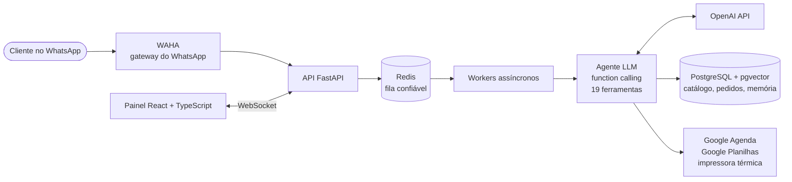
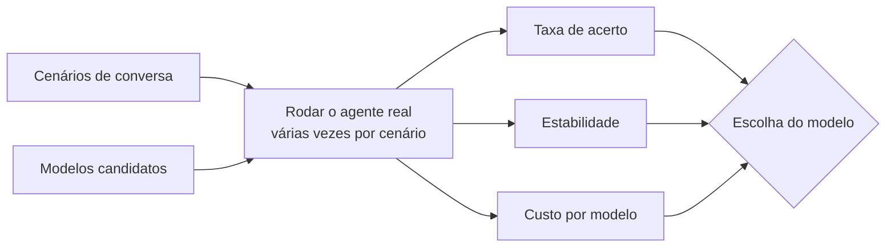

# Agente de IA para WhatsApp

Plataforma multiempresa (multi-tenant) em que um agente de IA atende o cliente no
WhatsApp de ponta a ponta: consulta o catálogo, monta e confirma pedidos, agenda
horários e transfere para atendimento humano.

Projeto pessoal, 2025 – atual. **Status:** em desenvolvimento; ainda não está em produção.

> O código é privado. Este repositório apresenta a arquitetura, as decisões
> técnicas e os números do projeto. Demonstro o código numa entrevista.

## Arquitetura

## Decisões técnicas

- **Fila confiável com Redis e workers.** Cada mensagem tem confirmação de
  processamento. Mensagens órfãs são reprocessadas, e as que falham de vez vão
  para uma dead-letter. Mensagens enviadas em sequência são agrupadas de forma
  atômica, para o agente responder uma vez só.
- **Busca semântica (RAG).** Embeddings em PostgreSQL + pgvector com índice HNSW,
  facetas por segmento (restaurante, petshop, pesca, caça, clínica) e
  enriquecimento dos itens por LLM na indexação.
- **Agente com ferramentas.** O LLM usa function calling com 19 ferramentas:
  catálogo, pedidos, agenda e transferência para humano.
- **Entrada multimodal.** Transcrição de áudio, leitura de imagem e extração de
  cardápio a partir de foto e PDF.
- **Memória do cliente em três camadas:** fatos declarados, hábitos de compra e
  resumo da conversa.
- **Multiempresa de verdade.** Isolamento de dados entre empresas, numeração
  atômica de pedidos, criptografia de dados sensíveis em nível de aplicação e
  controle de custo de tokens por empresa.
- **Prompts versionados** em releases, como código.

## Escolha do modelo por medição (evals)

As baterias de avaliação rodam o agente real em cenários repetidos e comparam
acerto, estabilidade e custo. A escolha do modelo segue essas medições.

## Qualidade

- Mais de 2.000 testes automatizados: pytest com Testcontainers sobre PostgreSQL
  e Redis reais, e Vitest no painel.
- Integrações com Google Agenda, Google Planilhas e impressora térmica
  implementadas; o teste de ponta a ponta com os serviços reais está pendente.

## Stack

Python · FastAPI · SQLAlchemy · Alembic · PostgreSQL · pgvector · Redis ·
OpenAI API · React · TypeScript · Vite · WebSocket · Docker · Linux

Roda em Docker num servidor Linux próprio.

---

[Leonardo Richeto](https://github.com/Leonardo-Richeto) ·
[LinkedIn](https://www.linkedin.com/in/leonardo-richeto-183a37215)
